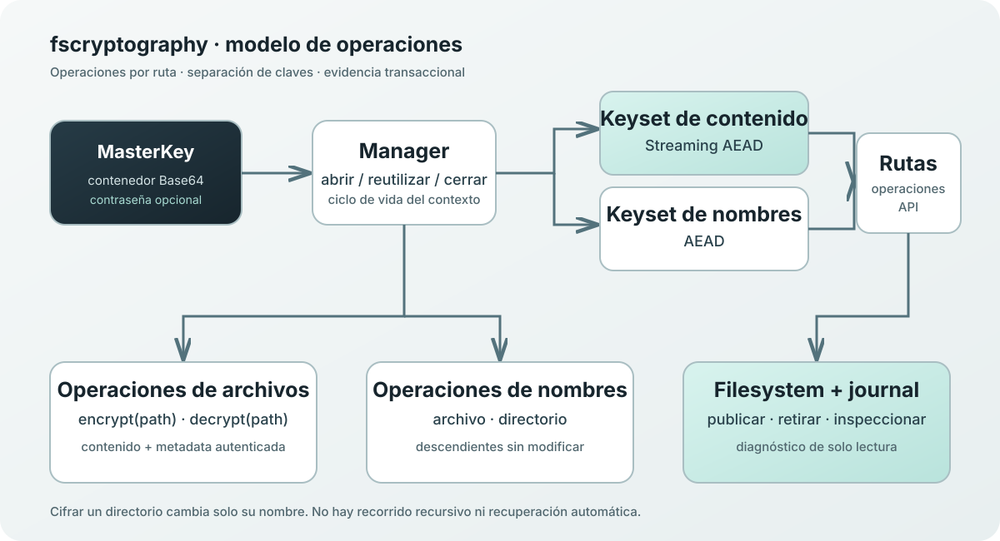

<h1 align="center">fscryptography</h1>

<strong>Cifrado autenticado orientado al sistema de archivos para Python.</strong> Protege el contenido de archivos y los nombres del filesystem mediante una API explícita basada en rutas.

<a href="#instalación">Instalación</a> · <a href="#inicio-rápido">Inicio rápido</a> · <a href="#manual-de-uso-de-la-api">Manual de API</a> · <a href="#modelo-de-seguridad">Seguridad</a> · <a href="docs/index.md">Documentación</a>

---

**fscryptography** (*filesystem-cryptography*) es una biblioteca Python para cifrar y descifrar archivos regulares y nombres del sistema de archivos mediante cifrado autenticado. Opera directamente sobre rutas y ofrece una API para generar claves, cifrar/descifrar archivos, proteger nombres e inspeccionar journals transaccionales en modo de solo lectura.

Es un componente criptográfico reutilizable; no es un explorador de directorios, una aplicación de respaldos, un filesystem virtual ni una API genérica para cifrar bytes o streams.

## Capacidades

| Capacidad | Descripción |
|---|---|
| Contenido de archivos | Cifrado autenticado y segmentado, también para archivos grandes |
| Nombres de archivos | Oculta el nombre completo mediante un formato autenticado |
| Nombres de directorios | Renombra un directorio sin recorrer ni cifrar sus descendientes |
| MasterKey | Contenedor versionado Base64, opcionalmente protegido con contraseña |
| Contexto reutilizable | Manager abre el material criptográfico y reutiliza primitivas Tink independientes |
| Journal | Conserva registros e incluye inspección de recuperación de solo lectura |
| Filesystem | Rechaza enlaces simbólicos y recursos no regulares; evita reemplazos accidentales |

## Instalación

Requiere **Python 3.11 o posterior**.

~~~bash
python -m pip install fscryptography
~~~

Para desarrollo:

~~~bash
git clone https://github.com/specter327/fscryptography.git
cd fscryptography
python -m pip install -e ".[dev]"
~~~

## Inicio rápido

~~~python
from pathlib import Path
import fscryptography

master_key = fscryptography.generate()

# Conserva la clave fuera del directorio protegido.
with fscryptography.Manager(key=master_key) as manager:
    manager.file.encrypt(Path("documento.txt"))
    manager.file.decrypt(Path("documento.fscrypt"))
~~~

Manager es un administrador de contexto. Al salir del bloque with, se cierra y libera sus referencias al material criptográfico activo.

## Manual de uso de la API

Guía práctica de la API pública. Las firmas normativas, contratos de retorno, excepciones y formatos están en la [referencia de API](docs/api-reference.md).

### 1. Generar una MasterKey

La clave se devuelve como texto Base64 canónico. Es un contenedor versionado, no una clave AES plana.

~~~python
import fscryptography

master_key = fscryptography.generate()
protected_key = fscryptography.generate(
    password="utiliza-una-frase-de-acceso-segura"
)
~~~

La variante protegida deriva una clave de envoltura con Argon2id y protege el contenedor mediante AES-256-GCM. La contraseña no se almacena en el valor devuelto. Conserva una copia de seguridad de la MasterKey: la contraseña no sustituye al contenedor de clave.

**Recomendaciones:** genera claves distintas para dominios de protección independientes; almacena el valor Base64 en un gestor de secretos; conserva respaldos separados de los datos protegidos; nunca publiques claves, contraseñas ni datos reales en el repositorio.

### 2. Abrir y cerrar un Manager

~~~python
manager = fscryptography.Manager(key=master_key)
try:
    manager.file.encrypt("informe.pdf")
finally:
    manager.close()
~~~

Para una MasterKey protegida:

~~~python
with fscryptography.Manager(
    key=protected_key,
    password="utiliza-una-frase-de-acceso-segura",
) as manager:
    manager.file.encrypt("confidencial.pdf")
~~~

La contraseña se consume al abrir la MasterKey y no se conserva en el gestor. Un Manager abierto puede atender varias operaciones. Después de close(), las operaciones que requieren el contexto fallan con ClosedInstanceError.

### 3. Cifrar y descifrar archivos

~~~python
with fscryptography.Manager(key=master_key) as manager:
    manager.file.encrypt("informe.txt")  # informe.fscrypt
    manager.file.encrypt("archivo.tar.gz", new_extension=".locked")
    manager.file.encrypt("payload.bin", new_extension="")
    manager.file.decrypt("informe.fscrypt")
    manager.file.decrypt("archivo.tar.locked")
~~~

- new_extension=None selecciona el sufijo predeterminado .fscrypt.
- Un sufijo como .locked sustituye la extensión original en el nombre cifrado.
- new_extension="" produce una salida sin extensión.
- La metadata de extensión original se autentica y restaura al descifrar.
- Las operaciones devuelven None al completarse; los fallos se comunican mediante excepciones.

El contenido se procesa por segmentos. El archivo completo no se carga en memoria como una sola cadena de bytes.

### 4. Cifrar el nombre y el contenido

~~~python
with fscryptography.Manager(key=master_key) as manager:
    manager.file.encrypt("expediente-cliente.txt", encrypt_name=True)
~~~

Con encrypt_name=True se cifra el nombre completo, que utiliza el marcador ~1. El contenido también se cifra. No combines esta opción con new_extension: la combinación se rechaza.

Para restaurar nombre y contenido, pasa la ruta cifrada real:

~~~python
manager.file.decrypt("~1...")
~~~

### 5. Cifrar el nombre de un directorio

~~~python
with fscryptography.Manager(key=master_key) as manager:
    manager.dir.encrypt("documentos-privados")
    manager.dir.decrypt("~1...")
~~~

La operación transforma exclusivamente el nombre del directorio. Sus entradas hijas no se recorren, renombran ni cifran.

> **Importante:** esto no es cifrado recursivo. Si los archivos internos también deben protegerse, cifra explícitamente cada archivo mediante su ruta. La biblioteca no recorre el árbol de directorios.

### 6. Exportar la MasterKey

~~~python
with fscryptography.Manager(key=master_key) as manager:
    backup_value = manager.export_key()
~~~

export_key() devuelve el contenedor activo como Base64 canónico. Trátalo como un secreto: Base64 es codificación, no cifrado.

### 7. Cambiar la clave activa

~~~python
new_master_key = fscryptography.generate()

with fscryptography.Manager(key=master_key) as manager:
    manager.change_key(new_master_key)
~~~

Para una nueva clave protegida, utiliza manager.change_key(new_protected_key, password="nueva-frase-de-acceso"). La nueva clave se abre completamente antes de sustituir el contexto; si falla, el contexto anterior permanece activo.

**Esto cambia la clave de operaciones posteriores; no vuelve a cifrar archivos existentes ni los migra a la nueva clave.** Conserva la clave original para los recursos que fueron cifrados con ella.

### 8. Inspeccionar transacciones

~~~python
with fscryptography.Manager(key=master_key) as manager:
    records = manager.inspect_recovery("/ruta/al/directorio-padre")

for record in records:
    print(record.transaction_id, record.operation, record.state, record.classification)
~~~

La inspección examina directorios transaccionales directamente bajo el directorio indicado y devuelve una tupla inmutable de RecoveryRecord. Es de solo lectura y no requiere la MasterKey.

Clasificaciones posibles: prepared_no_output, result_incomplete_or_unverified, result_ready, published_source_present, published_source_missing, source_retained, source_removed, ambiguous y corrupt.

La inspección es diagnóstica: no descifra, autentica, restaura, elimina ni limpia recursos. No borres journals basándote solo en su nombre o antigüedad.

### 9. Manejar excepciones

~~~python
import fscryptography

try:
    with fscryptography.Manager(key=master_key) as manager:
        manager.file.decrypt("documento.fscrypt")
except fscryptography.AuthenticationError:
    raise
except fscryptography.FsCryptographyError:
    raise
~~~

FsCryptographyError es la excepción base de la biblioteca. Los errores de argumentos también pueden utilizar TypeError y ValueError; los fallos ordinarios del filesystem conservan excepciones estándar cuando es posible. Consulta [errores y excepciones](docs/errors.md).

### Resumen de la API pública

| Símbolo | Propósito |
|---|---|
| fscryptography.generate(*, password=None) | Genera un contenedor MasterKey Base64 |
| fscryptography.Manager(key, *, password=None) | Abre un contexto criptográfico |
| manager.file.encrypt(path, *, new_extension=None, encrypt_name=False) | Cifra un archivo regular |
| manager.file.decrypt(path) | Descifra un archivo regular |
| manager.dir.encrypt(path) | Cifra solo el nombre de un directorio |
| manager.dir.decrypt(path) | Descifra solo el nombre de un directorio |
| manager.export_key() | Exporta la MasterKey activa |
| manager.change_key(new_key, *, password=None) | Sustituye el contexto activo |
| manager.inspect_recovery(parent) | Inspecciona journals en modo de solo lectura |
| manager.close() | Cierra el gestor |

## Modelo de seguridad

- **Contenido:** Google Tink Streaming AEAD con AES256_GCM_HKDF_1MB.
- **Nombres:** keyset AEAD independiente de Google Tink con AES256_GCM.
- **MasterKey protegida:** Argon2id v19 y envoltura AES-256-GCM.
- **Separación de claves:** contenido y nombres utilizan material criptográfico independiente.
- **Metadata autenticada:** cabecera versionada y metadata de extensión autenticadas.
- **Evidencia transaccional:** journals conservados para inspección explícita de solo lectura.

Consulta el [diseño criptográfico](docs/cryptographic-design.md), [formato MasterKey](docs/master-key-format.md), [formato de archivo](docs/file-format.md) y [journal](docs/recovery-journal.md).

## Alcance y compatibilidad

| Área | Contrato actual |
|---|---|
| Python | 3.11+ |
| Plataformas | GNU/Linux y Windows |
| Archivos | Solo archivos regulares; no se admiten enlaces simbólicos |
| Directorios | Directorios reales; solo se transforma su propio nombre |
| Procesamiento | Cifrado/descifrado por segmentos |
| Bytes/streams genéricos | Fuera de la API pública |
| Recorrido de directorios | No se realiza |
| Recuperación | Inspección de journal de solo lectura; sin recuperación o limpieza automática |

Las garantías dependen de la plataforma. GNU/Linux utiliza operaciones relativas a descriptores y publicación no-replace cuando está soportada. Windows utiliza una alternativa basada en rutas y no declara garantías equivalentes de anclaje de directorios, cuarentena del origen o durabilidad de entradas. Sistemas de archivos alternativos y de red no están validados exhaustivamente. No se afirma protección frente a procesos hostiles bajo la misma identidad de usuario.

## Documentación

- [Índice documental](docs/index.md)
- [Presentación técnica](docs/product-overview.md)
- [Referencia de API](docs/api-reference.md)
- [Arquitectura](docs/architecture.md)
- [Diseño criptográfico](docs/cryptographic-design.md)
- [Modelo de seguridad](docs/security-model.md)
- [Gestión de claves](docs/key-management.md)
- [Formato MasterKey](docs/master-key-format.md)
- [Cifrado de nombres](docs/filename-encryption.md)
- [Formato de archivos](docs/file-format.md)
- [Operaciones atómicas](docs/atomic-operations.md)
- [Journal de recuperación](docs/recovery-journal.md)
- [Compatibilidad](docs/platform-compatibility.md)
- [Errores y excepciones](docs/errors.md)
- [Publicación](docs/releasing.md)

## Pruebas y desarrollo

~~~bash
python -m pip install -e ".[dev]"
python -m pytest
python tests/real_resources/test_real_resources.py
python tests/manual_filesystem_demo.py
~~~

La demostración manual crea un espacio temporal aislado, opera sobre archivos y directorios reales, comprueba el round-trip y elimina los recursos generados al terminar.

Construcción de artefactos:

~~~bash
python -m build
python -m twine check dist/*
~~~

## Estado del proyecto

**Versión de distribución: 0.1.0 — Alpha.**

La API pública, el diseño criptográfico central, la documentación, el empaquetamiento y las pruebas de base están establecidos. Continúan pendientes pruebas de inyección de fallos y recuperación tras interrupciones, casos límite del filesystem y validación ampliada en combinaciones reales de sistemas operativos y sistemas de archivos. Son límites de validación explícitos, no garantías ya demostradas.

La suite no equivale a una auditoría criptográfica independiente. Esta versión alpha no sustituye respaldos, controles de acceso del sistema operativo, procedimientos de ciclo de vida de claves ni una revisión de seguridad apropiada para el modelo de amenazas.

## Licencia y derechos

Este proyecto es software propietario. **Todos los derechos reservados.** No se concede una licencia pública para usar, copiar, modificar o redistribuir el software. Cualquier autorización requiere permiso previo, expreso y por escrito del titular de los derechos.

Consulta [LICENSE](LICENSE). La disponibilidad pública del código y la distribución del paquete no conceden derechos adicionales.

---

Flujos criptográficos conscientes del filesystem · <a href="https://github.com/specter327/fscryptography">GitHub</a> · <a href="https://pypi.org/project/fscryptography/">PyPI</a>
