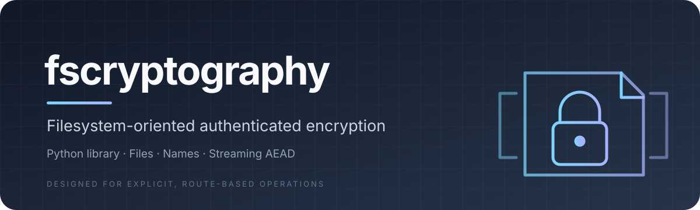
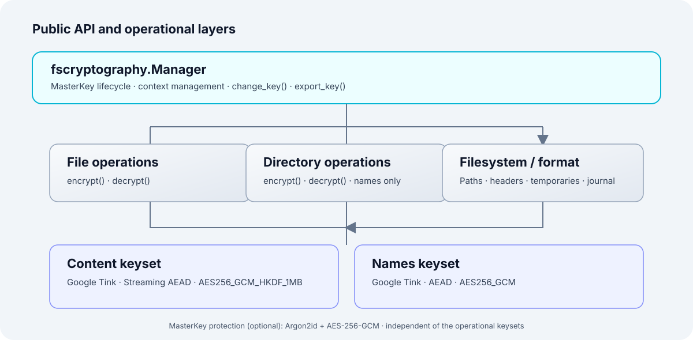
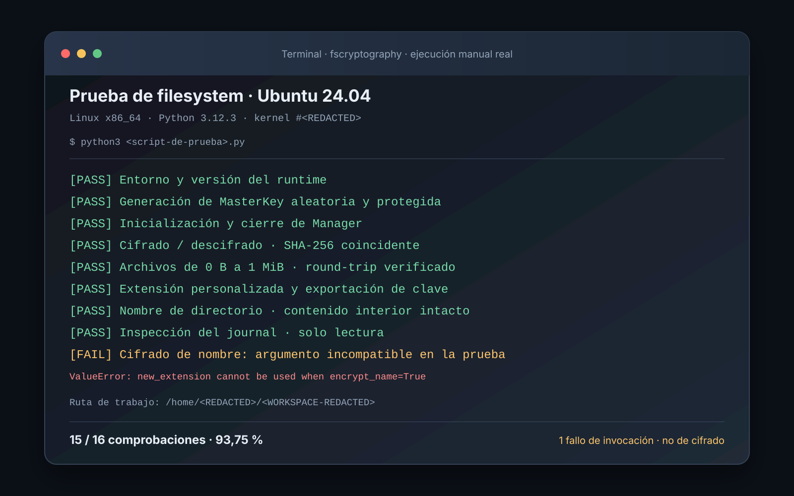

<div align="center">



[](https://pypi.org/project/fscryptography/)
[](https://pypi.org/project/fscryptography/)
[](https://github.com/specter327/fscryptography/actions)
[](LICENSE)
[](https://github.com/specter327/fscryptography/releases)

**Cifrado autenticado de archivos y nombres, directamente sobre el sistema de archivos.**

[Instalación](#instalación) · [Inicio rápido](#inicio-rápido) · [Manual de API](#manual-de-la-api) · [Arquitectura](#arquitectura) · [Seguridad](#seguridad) · [Documentación](#documentación)

</div>

---

## ¿Qué es fscryptography?

**fscryptography** (*filesystem cryptography*) es una librería Python para cifrar y descifrar archivos y transformar nombres de archivos y directorios mediante operaciones sobre rutas del sistema de archivos.

Ofrece una interfaz de alto nivel basada en `pathlib.Path` y `os.PathLike`, cifrado autenticado, procesamiento segmentado para archivos grandes y un contexto criptográfico reutilizable.

No es un filesystem virtual, un gestor de secretos ni una herramienta de cifrado genérico de bytes o streams. Su alcance es deliberadamente concreto: **proteger archivos y nombres existentes en el filesystem**.

## Características

- **Cifrado autenticado de contenido:** Google Tink Streaming AEAD con `AES256_GCM_HKDF_1MB`.
- **Procesamiento segmentado:** lectura y escritura secuencial en bloques de 1 MiB; no requiere cargar el archivo completo en memoria.
- **Cifrado de nombres:** AEAD independiente con `AES256_GCM` para nombres de archivos y directorios.
- **MasterKey autocontenida:** keysets independientes para contenido y nombres, transportados como Base64 estándar.
- **Protección opcional por contraseña:** Argon2id y AES-256-GCM para proteger el contenedor MasterKey.
- **Contexto reutilizable:** `Manager` abre las primitivas una vez y las reutiliza durante las operaciones.
- **Publicación sin sobrescritura:** evita reemplazar destinos existentes de forma accidental.
- **Errores tipados:** excepciones propias con una jerarquía pública, preservando errores estándar del filesystem cuando corresponde.
- **Inspección de transacciones:** diagnóstico de solo lectura de registros de operaciones interrumpidas.

## Instalación

Requisitos: **Python 3.11 o posterior**.

```bash
python -m pip install fscryptography
```

Comprueba la instalación:

```bash
python -c "import fscryptography; print(fscryptography.__version__)"
```

## Inicio rápido

El ejemplo siguiente cifra un archivo y posteriormente lo descifra. Las operaciones transforman el recurso en el filesystem: al completar correctamente el cifrado, el archivo original se retira y se publica el archivo cifrado; al descifrar, sucede lo inverso.

```python
from pathlib import Path

import fscryptography

# Genera una MasterKey aleatoria (contenedor autocontenido en Base64).
master_key = fscryptography.generate()

# Conserva esta clave fuera del directorio que vas a proteger.
# No la imprimas ni la incluyas en logs o en el control de versiones.
source = Path("documento.txt")

with fscryptography.Manager(key=master_key) as manager:
    manager.file.encrypt(source)
    # Resultado predeterminado: documento.fscrypt

    manager.file.decrypt(source.with_name("documento.fscrypt"))
    # Resultado: documento.txt
```

> **Importante:** el cifrado y descifrado de archivos son transformaciones del filesystem, no operaciones de copia. La librería no conserva automáticamente una segunda copia del recurso original. Realiza y verifica un backup antes de usarla con datos importantes.

## Manual de la API

### 1. Generar una MasterKey

`generate()` crea una MasterKey y devuelve su representación canónica como cadena Base64.

```python
import fscryptography

master_key: str = fscryptography.generate()
```

La cadena Base64 representa un contenedor de keysets, no una clave AES plana. Base64 es codificación, no cifrado: protege el valor como cualquier otro secreto.

### 2. Proteger la MasterKey con contraseña

Puedes generar el contenedor protegido mediante una contraseña:

```python
import fscryptography

password = obtain_password_from_secure_input()
master_key = fscryptography.generate(password=password)

with fscryptography.Manager(
    key=master_key,
    password=password,
) as manager:
    manager.file.encrypt("confidencial.pdf")
```

La contraseña se utiliza al abrir el contenedor y no se conserva dentro de `Manager`. Para volver a abrir una MasterKey protegida necesitarás tanto el contenedor como la contraseña correcta. La contraseña no sustituye el backup del contenedor.

La función `obtain_password_from_secure_input()` es ilustrativa: debe sustituirse por el mecanismo seguro de entrada o recuperación de secretos de tu aplicación.

### 3. Crear y administrar el contexto

`Manager` valida y abre el contenedor MasterKey. Mantiene las primitivas criptográficas preparadas para las operaciones posteriores.

```python
manager = fscryptography.Manager(key=master_key)

try:
    manager.file.encrypt("informe.txt")
finally:
    manager.close()
```

Se recomienda el administrador de contexto:

```python
with fscryptography.Manager(key=master_key) as manager:
    manager.file.encrypt("informe.txt")
```

Al salir del bloque, `close()` invalida el gestor y libera sus referencias al material criptográfico. Python no garantiza el borrado seguro de todas las copias de secretos en memoria.

### 4. Cifrar archivos

```python
from pathlib import Path

with fscryptography.Manager(key=master_key) as manager:
    # Salida predeterminada: reporte.fscrypt
    manager.file.encrypt(Path("reporte.txt"))

    # Extensión de salida personalizada: backup.locked
    manager.file.encrypt(
        Path("backup.tar.gz"),
        new_extension=".locked",
    )

    # Cadena vacía: salida sin extensión visible
    manager.file.encrypt(
        Path("datos.csv"),
        new_extension="",
    )
```

Parámetros:

| Parámetro | Tipo | Comportamiento |
|---|---|---|
| `path` | `str \| os.PathLike[str]` | Ruta del archivo regular que se va a cifrar. |
| `new_extension` | `str \| None` | `None` usa `.fscrypt`; `""` no añade extensión; un sufijo como `.locked` la sustituye. |
| `encrypt_name` | `bool` | Si es `True`, cifra el nombre completo del archivo. |

Para cifrar también el nombre:

```python
with fscryptography.Manager(key=master_key) as manager:
    manager.file.encrypt(
        "informe-confidencial.txt",
        encrypt_name=True,
    )
```

Cuando `encrypt_name=True`, no se puede especificar `new_extension`: el nombre completo se transforma mediante el codec de nombres.

### 5. Descifrar archivos

```python
with fscryptography.Manager(key=master_key) as manager:
    manager.file.decrypt("reporte.fscrypt")
```

El nombre de salida se obtiene de los metadatos autenticados del archivo. Si el nombre también estaba cifrado, se restaura mediante el keyset independiente de nombres.

El contenido se publica únicamente después de completar la autenticación del flujo. Un archivo alterado, truncado o no autenticable no debe tratarse como plaintext válido.

### 6. Cifrar y descifrar directorios

Las operaciones de directorio transforman **exclusivamente el nombre del directorio**. No recorren, cifran ni descifran los archivos que contiene.

```python
from pathlib import Path

directory = Path("proyecto-privado")

with fscryptography.Manager(key=master_key) as manager:
    # Captura las entradas existentes antes de la transformación.
    # Ejecuta este ejemplo sin modificaciones concurrentes en el padre.
    parent = directory.parent
    previous_entries = {item.name for item in parent.iterdir()}

    manager.dir.encrypt(directory)

    # La API transforma el nombre in-place y devuelve None.
    # Identifica la nueva entrada comparando el estado anterior y posterior.
    new_entries = [
        parent / name
        for name in (item.name for item in parent.iterdir())
        if name not in previous_entries
    ]
    if len(new_entries) != 1:
        raise RuntimeError(
            "No se pudo identificar de forma inequívoca el directorio cifrado"
        )

    encrypted_directory = new_entries[0]
    manager.dir.decrypt(encrypted_directory)
    # Restaura el nombre original.
```

Para proteger el contenido de un árbol de directorios, cada archivo debe procesarse explícitamente mediante la API de archivos y debe diseñarse una estrategia de recorrido y recuperación en la aplicación consumidora.

### 7. Cambiar y exportar la MasterKey

`change_key()` abre y valida la nueva clave antes de reemplazar el contexto activo. Si la apertura falla, el contexto anterior permanece activo.

```python
new_key = fscryptography.generate()

with fscryptography.Manager(key=master_key) as manager:
    manager.change_key(new_key)

    exported_key: str = manager.export_key()
```

Para cambiar a un contenedor protegido por contraseña:

```python
protected_key = fscryptography.generate(password=new_password)

with fscryptography.Manager(key=master_key) as manager:
    manager.change_key(
        protected_key,
        password=new_password,
    )
```

`export_key()` devuelve la MasterKey activa en Base64 estándar. Trata el valor exportado como un secreto de máxima sensibilidad.

### 8. Inspeccionar registros de recuperación

`inspect_recovery(parent)` permite consultar registros de transacciones bajo un directorio padre:

```python
with fscryptography.Manager(key=master_key) as manager:
    records = manager.inspect_recovery("/ruta/al/directorio")

    for record in records:
        print(record)
```

La inspección es de solo lectura. No descifra, restaura, elimina ni resuelve transacciones. Una clasificación de estado no autoriza por sí misma a modificar o borrar recursos. Conserva los registros y archivos asociados hasta realizar una evaluación explícita.

### 9. Excepciones

Las excepciones propias se exportan desde el paquete raíz y derivan de `FsCryptographyError`.

| Excepción | Significado |
|---|---|
| `FsCryptographyError` | Clase base de errores propios. |
| `AuthenticationError` | Fallo de autenticación de contenido o contenedor protegido. |
| `FormatError` | Formato, cabecera o estructura no válida. |
| `UnsupportedFormatVersionError` | Versión no admitida. |
| `InvalidPathError` | Ruta no utilizable o identidad de recurso alterada durante el inicio. |
| `UnsupportedResourceError` | Tipo de recurso no admitido, por ejemplo un enlace simbólico. |
| `DestinationConflictError` | El destino ya existe; no se sobrescribe por defecto. |
| `NameConstraintError` | Nombre no representable o fuera de los límites aplicables. |
| `KeyDerivationError` | Fallo operativo al derivar una clave. |
| `BackendError` | Fallo inesperado de integración criptográfica. |
| `ClosedInstanceError` | Se intentó usar un gestor cerrado. |
| `AtomicOperationError` | No se pudo asegurar el estado esperado durante la operación. |
| `RecoveryError` | Falló también la recuperación o rollback. |

Los errores ordinarios del sistema de archivos pueden conservar excepciones estándar como `FileNotFoundError`, `FileExistsError`, `PermissionError` y `OSError`. Los errores de argumentos pueden ser `TypeError` o `ValueError`.

Para el contrato completo y las reglas de clasificación, consulta [docs/errors.md](docs/errors.md).

## Arquitectura

La API pública mantiene separado el ciclo de vida de claves, las operaciones de filesystem, el formato y el backend criptográfico.

<div align="center">

</div>

Flujo simplificado de una transformación de archivo:

1. Validación de ruta, tipo de recurso y destino.
2. Creación de un temporal exclusivo en el mismo filesystem.
3. Escritura de cabecera y procesamiento Streaming AEAD por segmentos.
4. Finalización y sincronización del temporal.
5. Publicación sin reemplazar un destino existente.
6. Retiro del origen y sincronización del namespace cuando la plataforma lo permite.

La implementación no debe publicar plaintext parcial como resultado definitivo. La semántica de durabilidad y las garantías de operaciones del filesystem dependen de la plataforma.


## Evidencia de ejecución real

La siguiente lámina resume una ejecución manual reportada en **Ubuntu 24.04, Linux x86_64 y Python 3.12.3**. Se han censurado la ruta de trabajo y los identificadores del entorno. Es una **reconstrucción vectorial de la salida y los resultados**, no una captura binaria del terminal original.

<div align="center">
  
</div>

**Resultado informado: 15/16 comprobaciones correctas (93,75 %).** Las operaciones de cifrado y descifrado verificadas conservaron la integridad de los datos mediante SHA-256, incluidos archivos de hasta 1 MiB. La única comprobación fallida fue una invocación incompatible de la API: se pasó `new_extension` junto con `encrypt_name=True`, combinación que la API rechaza intencionalmente. Para cifrar el nombre se debe omitir `new_extension`.

Esta evidencia documenta una ejecución en un entorno concreto; no sustituye las pruebas automatizadas, las pruebas de endurecimiento ni la validación multiplataforma. No se muestran claves, contraseñas, contenido privado ni rutas personales.

## Diseño criptográfico

| Dominio | Tecnología | Uso |
|---|---|---|
| Contenido | Tink Streaming AEAD · `AES256_GCM_HKDF_1MB` | Cifrado autenticado y segmentado de archivos. |
| Nombres | Tink AEAD · `AES256_GCM` | Protección de nombres de archivos y directorios. |
| Protección de MasterKey | Argon2id + AES-256-GCM | Protección opcional del contenedor mediante contraseña. |

Los keysets de contenido y nombres son independientes. La generación de nonces y las primitivas AEAD se delegan al backend seleccionado; la librería no implementa algoritmos criptográficos propios.

## Compatibilidad y estado

- Python: requisito declarado `>=3.11`.
- Objetivos declarados: Windows 11 y GNU/Linux (Ubuntu 22.04/24.04 LTS), x86-64; Python 3.11–3.13.
- Integración filesystem validada en CI sobre Ubuntu 22.04.5/24.04.5 con ext4 y Windows Server 2025 Datacenter (build 26100) con NTFS.
- Windows 11 cliente todavía requiere validación específica; Windows Server 2025 no se presenta como sustituto de esa prueba.
- La matriz CI valida los runners y opciones de filesystem observados, no todas las versiones de kernel, dispositivos, configuraciones de montaje ni condiciones de pérdida de energía.

Consulta [docs/platform-compatibility.md](docs/platform-compatibility.md) para ver los entornos exactos, opciones de montaje y límites de extrapolación.

## Seguridad

Esta librería manipula claves criptográficas y recursos del usuario. Antes de integrarla en un flujo sensible:

- Lee el [modelo de seguridad](docs/security-model.md) y la [política de reporte de vulnerabilidades](SECURITY.md).
- Define un procedimiento de backup y recuperación de MasterKey.
- Protege la MasterKey y, cuando aplique, su contraseña fuera del árbol cifrado.
- Prueba primero con datos desechables y verifica el resultado.
- No ejecutes operaciones destructivas sin backups recuperables.
- No asumas protección frente a malware, procesos privilegiados o procesos hostiles bajo el mismo usuario.
- No interpretes el cifrado como protección de metadatos: tamaños, cantidad de archivos, permisos, timestamps y patrones de acceso pueden seguir expuestos.
- Las operaciones de archivo rechazan recursos con hard links múltiples y crean resultados nuevos; no preservan automáticamente permisos, propietario, ACL, timestamps, xattrs ni alternate data streams. Consulta el [contrato de metadatos y enlaces](docs/atomic-operations.md#enlaces-duros-y-contrato-de-metadatos-fase-de-endurecimiento).

**La implementación y sus pruebas automatizadas no equivalen a una auditoría criptográfica independiente.** No se garantiza borrado seguro de secretos en memoria Python ni durabilidad uniforme en todos los filesystems.

## Documentación técnica

La documentación normativa y de diseño se mantiene separada del manual de uso:

- [Índice de documentación](docs/index.md)
- [Contrato de API](docs/api-reference.md)
- [Arquitectura](docs/architecture.md)
- [Diseño criptográfico](docs/cryptographic-design.md)
- [Formato de archivos](docs/file-format.md)
- [Formato MasterKey](docs/master-key-format.md)
- [Gestión de claves](docs/key-management.md)
- [Política Argon2id](docs/argon2id-policy.md)
- [Cifrado de nombres](docs/filename-encryption.md)
- [Operaciones atómicas](docs/atomic-operations.md)
- [Journal y recuperación](docs/recovery-journal.md)
- [Errores y excepciones](docs/errors.md)
- [Modelo de seguridad](docs/security-model.md)
- [Política de seguridad y reporte de vulnerabilidades](SECURITY.md)
- [Compatibilidad de plataformas](docs/platform-compatibility.md)
- [Construcción y publicación](docs/releasing.md)
- [Decisión de arquitectura inicial](docs/decisions/0001-initial-design.md)

## Desarrollo

Clona el repositorio e instala dependencias de desarrollo:

```bash
git clone https://github.com/specter327/fscryptography.git
cd fscryptography
python -m pip install -e ".[dev]"
```

Ejecuta las pruebas:

```bash
python -m pytest
```

Construye y valida los artefactos:

```bash
python -m build
python -m twine check dist/*
```

## Licencia y derechos de uso

**Software propietario — todos los derechos reservados.**

No se concede una licencia pública para usar, copiar, modificar o redistribuir este software. Cualquier autorización requiere permiso previo y expreso por escrito del titular de los derechos.

La disponibilidad del código fuente en GitHub o del paquete en PyPI no implica la concesión de derechos adicionales. Consulta [LICENSE](LICENSE).

---

<div align="center">

**fscryptography** · filesystem-oriented authenticated encryption

[GitHub](https://github.com/specter327/fscryptography) · [PyPI](https://pypi.org/project/fscryptography/) · [Documentación](docs/index.md) · [Issues](https://github.com/specter327/fscryptography/issues)

</div>
